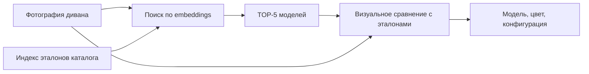

# Sofa Recognition

Приложение для поиска модели дивана по фотографии и сравнения мультимодальных
подходов к распознаванию мебели. Возвращает название модели из заданного каталога,
цвет и конфигурацию; позволяет сопоставить качество ответов, время и стоимость API.

Проект реализован как локальный Streamlit MVP. Он предназначен для экспериментов
с Vision-моделями и поиском по embeddings через OpenRouter.

## Как это работает

Пользователь загружает фотографию, выбирает метод и получает результат рядом
с эталоном из каталога. Интерфейс показывает кандидатов, структурированный ответ
и позволяет перейти к пакетному сравнению на размеченном наборе.

Схема гибридного режима:



Пример формата результата — иллюстрация, а не результат измеренного эксперимента:

```json
{
  "model": "Elias",
  "color": "Серый",
  "configuration": "Угловой"
}
```

Любой из трёх параметров может быть `null`, если модель не определила его.

## Возможности

- Пять режимов распознавания: Vision Only, Cohere Embeddings, Voyage Embeddings,
  Cohere + Vision и Voyage + Vision.
- Загрузка своего фото, просмотр тестового набора и самопроверка каталога.
- Сравнение исходного изображения с эталонами и просмотр TOP-5 кандидатов.
- Выбор моделей и редактирование промпта в интерфейсе.
- Пакетные эксперименты с метриками качества, временем, стоимостью и экспортом JSON.
- Отдельные индексы провайдеров и файловый кэш для повторных запросов.

## Инженерные решения

| Решение | Зачем оно нужно |
|---|---|
| Поиск по embeddings перед Vision | Ограничивает визуальное сравнение пятью моделями каталога; влияние на качество и расходы можно измерить в эксперименте |
| JSON Schema и проверка Pydantic | Ограничивают структуру ответа, палитру цветов и допустимые значения; невалидные ответы не попадают в успешный кэш |
| Хэши запросов, изображений и каталога | Позволяют переиспользовать ответы и обнаруживать необходимость пересборки индекса |
| Исключение точных копий по SHA-256 | Не позволяет использовать то же изображение как собственный эталон при самопроверке |
| Общая выборка для сравнения экспериментов | Помогает сопоставлять методы на одних и тех же фотографиях |
| Офлайн-тесты с MockTransport | Проверяют логику приложения без платных запросов к AI API |

Стек: **Python 3.13 · Streamlit · Pydantic · NumPy · Pillow · HTTPX · Loguru**.
Зависимости управляются через uv, команды проекта — через mise; проверки — pytest и Ruff.
Поиск реализован на NumPy без отдельной векторной базы данных.

Подробнее: [архитектура, API и хранение](docs/architecture.md).

## Быстрый запуск

Потребуются Python 3.13, mise, uv и API-ключ OpenRouter. Выполняйте команды из корня
репозитория. Запросы распознавания и построения индексов могут быть платными.

1. Установите зависимости из lock-файла:

   ```sh
   mise run setup
   ```

2. Создайте `.env` по образцу `.env.example` и задайте `OPENROUTER_API_KEY`.
3. Подготовьте `data/catalog/catalog.json` и эталонные фотографии рядом с ним.
   **Каталог и изображения не входят в репозиторий.** Можно использовать собственные
   данные по [минимальному примеру](docs/usage.md#каталог-эталонов).
4. Запустите приложение:

   ```sh
   mise run start
   ```

5. Откройте <http://127.0.0.1:8501>, выберите источник «Загрузить фото» и режим
   Vision Only. Для режимов с embeddings сначала постройте соответствующий индекс
   в разделе «Индексы».

Приложение читает `.env` автоматически; переменные процесса имеют приоритет.
Альтернативные команды для Windows и macOS, форматы данных и порядок эксперимента
описаны в [руководстве пользователя](docs/usage.md).

## Проверки и статус

```sh
mise run check
```

Команда выполняет Ruff, проверку форматирования и офлайн-тесты pytest. Тесты
охватывают режимы распознавания, кэш, индексы, валидацию ответов, метрики
и интерфейс через Streamlit AppTest. Реальный HTTP-транспорт запрещён тестовой fixture.

MVP реализует сценарии распознавания и сравнения. Сравнительный отчёт по качеству,
скорости и стоимости на независимой размеченной выборке пока не опубликован;
предпочтительный метод не выбран. Автоматические тесты проверяют логику приложения,
но не подтверждают качество реальных AI-моделей.

Основные ограничения:

- Модель мебели выбирается из предоставленного каталога; при неопределённости возможен `null`.
- В режимах без Vision определяются только модель и кандидаты; цвет и конфигурация — `null`.
- Cosine similarity не является вероятностью; порог отказа требует калибровки.
- Самопроверка исключает точные копии, но не перекодированные или визуально близкие дубликаты.

Следующий этап — независимая оценка всех пяти режимов и калибровка порога.
Метрики, учёт расходов и порядок оценки: [методика экспериментов](docs/evaluation.md).
