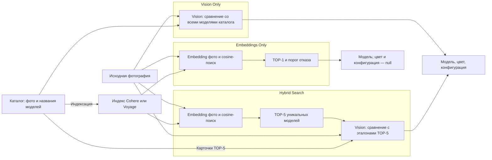

# Sofa Recognition — AI Vision & Image Retrieval Benchmark

Приложение для поиска модели дивана по фотографии и сравнения мультимодальных
подходов к распознаванию мебели. Возвращает название модели из заданного каталога,
а в режимах с Vision — также цвет и конфигурацию; позволяет сопоставить качество
ответов, время и стоимость API.

Проект реализован как локальный Streamlit MVP. Он предназначен для экспериментов
с Vision-моделями и поиском по embeddings через OpenRouter.

## Как это работает

Пользователь загружает фотографию, выбирает метод и получает результат рядом
с эталоном из каталога. Интерфейс показывает кандидатов, структурированный ответ
и позволяет перейти к пакетному сравнению на размеченном наборе.

Три подхода к распознаванию:



Vision получает исходное фото и подписанные карточки эталонов, до трёх ракурсов
на модель. В Vision Only кандидатов ранжирует LLM; в гибридных режимах их задаёт
поиск по embeddings. Порог cosine применяется только в Embeddings Only.

Пример формата результата — иллюстрация, а не результат измеренного эксперимента:

```json
{
  "model": "Elias",
  "color": "Серый",
  "configuration": "Угловой"
}
```

Любой из трёх параметров может быть `null`, если модель не определила его.

## Возможности

- Пять режимов распознавания: Vision Only, Cohere Embeddings, Voyage Embeddings,
  Cohere + Vision и Voyage + Vision.
- Загрузка своего фото, просмотр тестового набора и самопроверка каталога.
- Сравнение исходного изображения с эталонами и просмотр TOP-5 кандидатов.
- Выбор моделей и редактирование промпта в интерфейсе.
- Пакетные эксперименты с метриками качества, временем, стоимостью и экспортом JSON.
- Отдельные индексы провайдеров и файловый кэш для повторных запросов.

| Режим | Выбор модели мебели | Цвет | Конфигурация |
|---|---|---|---|
| Vision Only | Vision сравнивает со всеми доступными моделями каталога | По исходному фото | По исходному фото |
| Cohere Embeddings | TOP-1 по cosine в индексе Cohere, с порогом отказа | `null` | `null` |
| Voyage Embeddings | TOP-1 по cosine в индексе Voyage, с порогом отказа | `null` | `null` |
| Cohere + Vision | Cohere TOP-5 → выбор Vision по эталонам | По исходному фото | По исходному фото |
| Voyage + Vision | Voyage TOP-5 → выбор Vision по эталонам | По исходному фото | По исходному фото |

Цвет и конфигурацию определяет Vision, без копирования параметров эталона.
Любой режим может вернуть `null` для модели мебели.

## Инженерные решения

| Решение | Зачем оно нужно |
|---|---|
| Cosine similarity и NumPy | Скалярное произведение L2-нормализованных векторов даёт локальный поиск без векторной БД |
| TOP-5 уникальных моделей | Лучший ракурс представляет модель; её остальные фото не занимают места других кандидатов |
| Поиск по embeddings перед Vision | Ограничивает визуальное сравнение пятью моделями каталога; влияние на качество и расходы можно измерить в эксперименте |
| JSON Schema и проверка Pydantic | Ограничивают структуру ответа, палитру цветов и допустимые значения; невалидные ответы не попадают в успешный кэш |
| Инвалидация индексов и кэша | Подпись индекса учитывает модель, каталог, фото и preprocessing; ключ API-кэша — URL и полный запрос |
| Исключение точных копий по SHA-256 | Убирает копии исходного фото из retrieval и Vision-эталонов, даже при другом имени файла |
| Общая выборка для сравнения экспериментов | Помогает сопоставлять методы на одних и тех же фотографиях |
| Атомарные JSON-записи | Временный файл и `os.replace` защищают кэш и журнал от частично записанного JSON |
| Изолированные проверки | MockTransport, тестовый ключ и временные файлы; fixture запрещает реальный HTTP-транспорт |

Стек: **Python 3.13 · Streamlit · Pydantic · NumPy · Pillow · HTTPX · Loguru**.
Зависимости управляются через uv, команды проекта — через mise; проверки — pytest и Ruff.
Поиск реализован на NumPy без отдельной векторной базы данных.

Подробнее: [архитектура, API и хранение](docs/architecture.md).

## Методика сравнения

Качество оценивается отдельно для модели, цвета и конфигурации по известной разметке:

| Метрика | Определение |
|---|---|
| Accuracy | Правильные ответы / известные значения; отказы считаются ошибками |
| Coverage | Определённые ответы / известные значения |
| Answered accuracy | Правильные ответы / определённые ответы среди известных значений |
| TOP-5 recall | Доля фото с известной моделью, для которых она присутствует среди кандидатов |
| Время обработки | Полное локальное время: preprocessing, поиск и HTTP |
| Стоимость API | `usage.cost`; неизвестная цена — `null`, локальный кэш — $0 новых расходов |

`null` в разметке исключает параметр из оценки; при пустом знаменателе метрика
не определена. Для качества берётся последний результат каждого SHA-256 фото;
эксперименты можно сравнивать на общей выборке. Средние время и стоимость API
учитывают только запуски полностью без кэша; повторные запуски входят в расходы.
Стоимость построения индексов хранится отдельно и не входит в сводку распознавания.
Расходы на оборванные и невалидные ответы нужно сверять с биллингом OpenRouter.
Подробности: [методика экспериментов](docs/evaluation.md).

## Быстрый запуск

Предварительно установите [mise](https://mise.jdx.dev/getting-started.html)
и [uv](https://docs.astral.sh/uv/getting-started/installation/), доступные в `PATH`.
Потребуется API-ключ OpenRouter. Выполняйте команды из корня репозитория.

**Возможны платные запросы при распознавании и построении индексов.
Автораспознавание включено по умолчанию: переключение фотографий также может
вызвать платный запрос.**

1. Подготовьте Python 3.13 из `mise.toml` и зависимости из lock-файла:

   ```sh
   mise install
   mise run setup
   ```

   mise выбирает Python; uv создаёт `.venv` через `uv sync --locked`.
   Автоматическая установка Python при запуске задач отключена в конфигурации.

2. Создайте `.env` по образцу `.env.example` и задайте `OPENROUTER_API_KEY`.
3. Подготовьте `data/catalog/catalog.json` и эталонные фотографии рядом с ним.
   **Каталог и изображения не входят в репозиторий.** Можно использовать собственные
   данные по [минимальному примеру](docs/usage.md#каталог-эталонов).
4. Запустите приложение:

   ```sh
   mise run start
   ```

5. Откройте <http://127.0.0.1:8501>, выберите источник «Загрузить фото» и режим
   Vision Only. Для режимов с embeddings сначала постройте соответствующий индекс
   в разделе «Индексы».

Приложение читает `.env` автоматически; переменные процесса имеют приоритет.
Альтернативные команды для Windows и macOS, форматы данных и порядок эксперимента
описаны в [руководстве пользователя](docs/usage.md).

## Проверки и статус

```sh
mise run check
```

Команда выполняет Ruff, проверку форматирования и офлайн-тесты pytest. Тесты
охватывают режимы распознавания, кэш, индексы, валидацию ответов, метрики
и интерфейс через Streamlit AppTest. Реальный HTTP-транспорт запрещён тестовой fixture.

MVP реализует сценарии распознавания и сравнения. Сравнительный отчёт по качеству,
скорости и стоимости на независимой размеченной выборке пока не опубликован;
предпочтительный метод не выбран. Автоматические тесты проверяют логику приложения,
но не подтверждают качество реальных AI-моделей.

Основные ограничения:

- Модель мебели выбирается из предоставленного каталога; при неопределённости возможен `null`.
- В режимах без Vision определяются только модель и кандидаты; цвет и конфигурация — `null`.
- Cosine similarity не является вероятностью; порог отказа требует калибровки.
- Самопроверка исключает точные копии, но не перекодированные или визуально близкие дубликаты.

Следующий этап — независимая оценка всех пяти режимов и калибровка порога.

## Документация

- [Оглавление технической документации](docs/README.md).
- [Запуск, форматы данных и работа с интерфейсом](docs/usage.md).
- [Архитектура, API и хранение](docs/architecture.md).
- [Метрики, расходы и порядок оценки](docs/evaluation.md).
- [Текущее состояние и открытые задачи](docs/PROJECT_STATUS.md).
